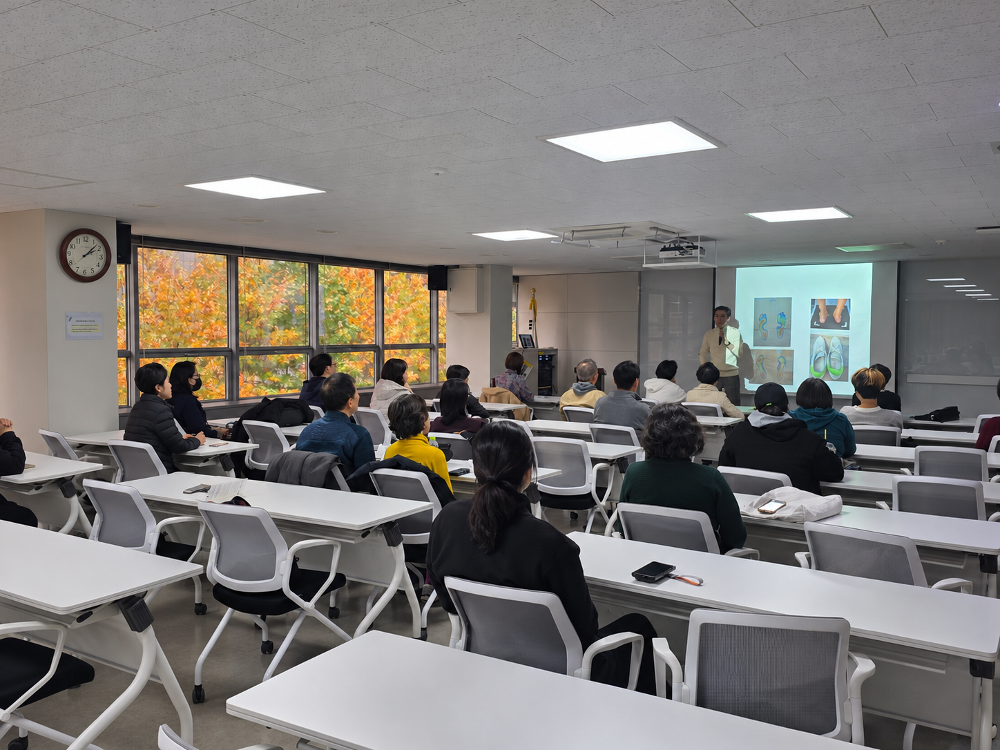
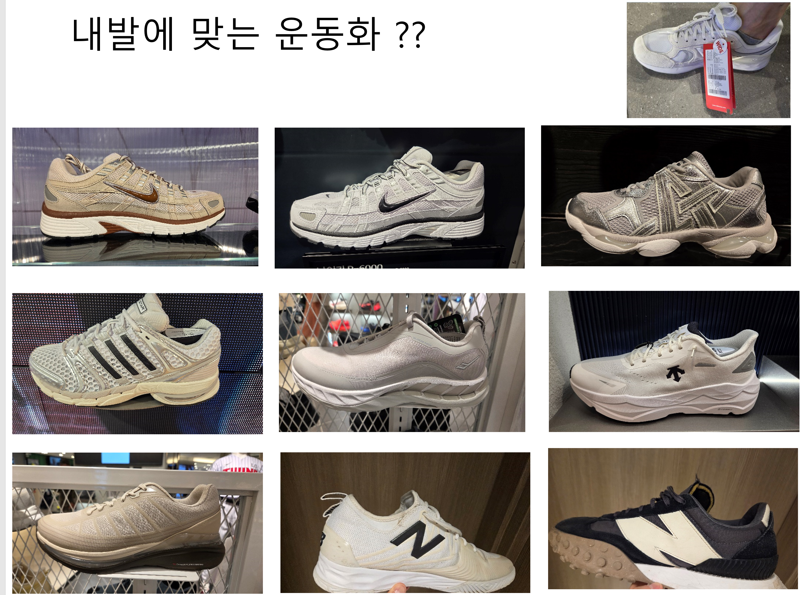
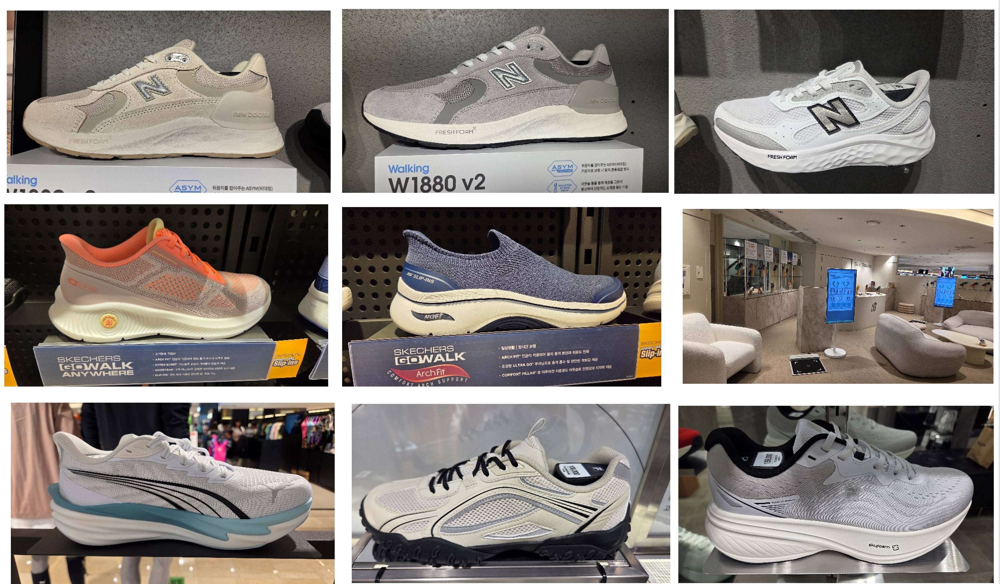
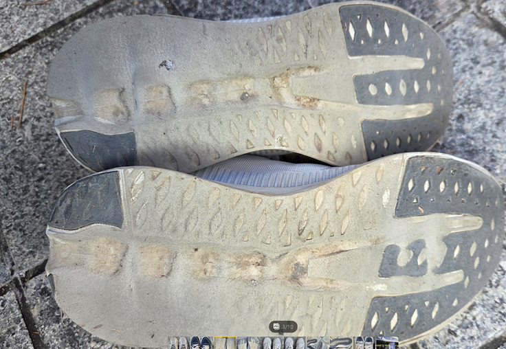
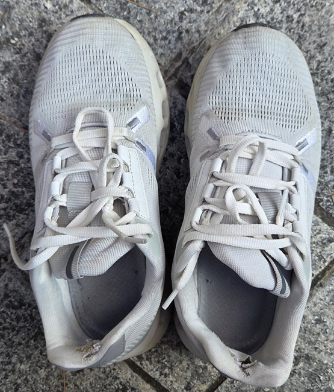

# 송파구보건소 바른자세걷기 교육, 내 발과 신발부터 살펴보다

## 걷기 좋은 송파에서 내 걸음을 돌아보다

올림픽공원과 석촌호수가 있는 송파는 일상 가까이에서 걷는 즐거움을 만날 수 있는 곳입니다. 익숙한 산책길을 더 편안하게 걷기 위해서는 자신의 발과 신발에도 관심을 기울일 필요가 있습니다. 2026년 11월 13일 송파구보건소에서 열린 바른자세걷기 교육에는 40여 명이 참석했습니다. 이번 교육은 내 발에 실리는 압력을 이해하고, 올바른 신발 선택과 착용의 중요성을 함께 살펴보는 시간이었습니다. 얼마나 많이 걸을까 하는 질문에서 한 걸음 더 나아가, 지금 내 발이 어떤 상태로 걷고 있는지 생각해보는 자리였습니다.

## 족압 화면으로 살펴본 발의 역할

교육에서는 족압을 통해 발바닥에 압력이 어떻게 분포하는지 이해하는 내용을 다뤘습니다. 현장 사진에도 족압 이미지와 발, 신발 자료를 함께 보여주는 강의 장면이 담겨 있습니다. 평소 눈에 잘 보이지 않는 발의 움직임을 화면과 연결해 살펴보면 자신의 걸음에 대한 질문도 구체적으로 만들 수 있습니다. 다만 압력 분포만으로 질환을 스스로 진단하거나 특정 신발이 필요하다고 판단해서는 안 됩니다. 발이 불편했던 상황과 걷는 환경을 함께 정리해 전문가와 이야기하는 자료로 활용하는 것이 좋습니다.

## 뒤꿈치 지지 구조를 살피는 신발 예시

함께 소개한 신발 사진은 뒤꿈치를 안정적으로 지지하는 구조를 살펴보기 위한 예시입니다. 자료를 제공한 취지는 종골, 즉 뒤꿈치뼈 주변이 과도하게 기울거나 흔들리는 것을 줄이는 데 도움이 될 수 있는 특징에 주목하는 것입니다. 미국정형외과학회는 신발 뒤쪽의 힐 카운터가 뒤꿈치를 잡아주는 부분이며, 단단한 구조가 뒤꿈치 조절과 안정성을 더한다고 설명합니다.[1] 브랜드나 모양보다 실제로 뒤꿈치가 편안하게 잡히는지 확인해야 합니다. 개인의 발 상태에 맞는 선택이 우선입니다.

## 내 발에 맞는지는 양쪽을 신어봐야 알 수 있습니다

이번 교육은 신발을 고르는 기준을 생활과 연결해 살펴봤다는 점에서도 의미가 있습니다. 독자가 직접 신발을 고를 때는 양쪽을 모두 신어보고 발가락이 움직일 공간, 발볼과 발등의 압박, 뒤꿈치의 착용감을 확인해보세요. 영국 NHS의 신발 안내는 양발에 잘 맞는지 살피고, 발가락을 위한 길이·폭·깊이와 편안한 뒤꿈치 고정을 확인하도록 권합니다.[2][3] 같은 크기로 표시된 신발도 실제 느낌은 다를 수 있습니다. 사진 속 제품을 그대로 고르기보다 자신의 발과 걷는 목적을 기준으로 비교하는 과정이 중요합니다.

## 착용법과 교체 신호를 함께 점검하세요

신발을 고르는 것만큼 올바르게 신는 방법과 사용 중 상태를 살피는 일도 중요합니다. 발을 넣은 뒤 끈이나 스트랩을 조절하고, 걸을 때 안에서 발이 불필요하게 미끄러지지 않는지 확인해보세요. NHS는 조절 가능한 잠금 장치가 발을 잡아주고 마찰을 줄이는 데 도움이 된다고 안내합니다.[2][3] 함께 제공된 사용 신발 사진에는 바닥 무늬가 많이 닳은 부분과 뒤축 안감의 손상이 보입니다. 잘못된 착용과 교체 시기 점검을 위한 사례로, 내 신발의 바닥과 뒤꿈치 안쪽도 돌아보게 합니다. 끈 조절로 해결되지 않는 손상이나 불안정함이 있다면 교체를 검토하고, 통증·저림·피부 손상이 있으면 전문가와 상담하세요.

## 배움과 따뜻한 기억을 일상으로 가져가기

교육을 전한 메모에는 여행 중 우연히 들른 맛집에서 음식뿐 아니라 친절한 응대까지 만나 행복했던 순간에 빗댄 따뜻한 마음이 담겨 있었습니다. 알찬 내용과 사람을 향한 배려가 함께할 때 만남은 오래 기억에 남습니다. 이번 배움도 다음 산책을 준비하는 작은 습관으로 이어지길 바랍니다. 오늘 신발을 신기 전에 뒤꿈치가 편안한지, 발가락이 답답하지 않은지, 끈이 알맞게 조절됐는지 살펴보세요. 내 발을 이해하고 신발을 제대로 선택해 착용하는 관심이 바른자세걷기를 생활에서 실천하는 출발점이 됩니다.

### 자료와 사진 출처

행사 날짜·참석 규모·교육 내용·현장 소감과 사진은 사용자 제공 자료를 바탕으로 작성했습니다. 아래 자료는 일반적인 신발 선택·착용 안내의 보강 근거입니다.

[1] [AAOS OrthoInfo · Shoes: Finding the Right Fit](https://www.orthoinfo.org/bodypart/foot-ankle/shoes-finding-the-right-fit/) · 2026년 11월 16일 확인.

[2] [Bradford District Care NHS · Footwear advice](https://www.bdct.nhs.uk/footwear-advice/) · 2026년 11월 16일 확인.

[3] [NHS Forth Valley · Footwear Advice](https://nhsforthvalley.com/health-services/az-of-services/podiatry/musculoskeletal-podiatry/footwear-advice/) · 2026년 11월 16일 확인.
