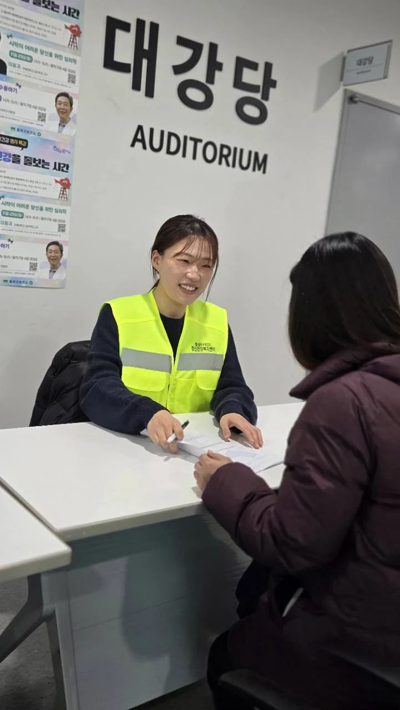
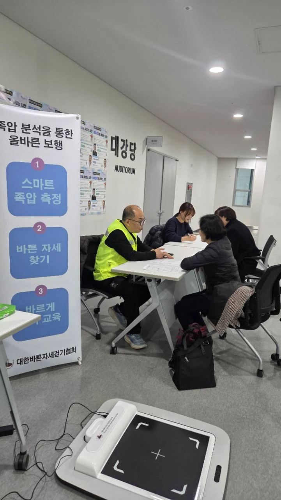
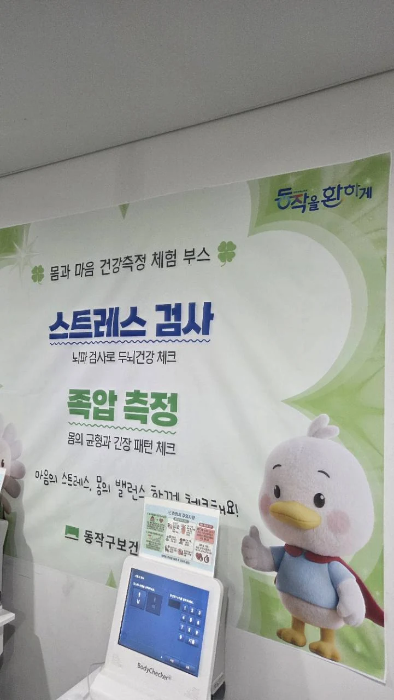

# 동작구청에서 만난 내 발 이야기, 족압 측정에서 운동화 선택까지

## 동작구민 90여 명과 함께 살펴본 발 건강

매일 신고 걷는 운동화가 내 발에 맞는지, 오래 서 있으면 왜 무릎이나 허리가 불편한지 궁금할 때가 있습니다. 대한바른자세걷기협회는 2026년 11월 23일 동작구청 건강측정 체험 행사에서 이런 질문을 나누는 족압 측정과 상담을 진행했습니다. 협회 제공 집계에 따르면 구청장을 포함한 동작구민 90여 명이 검사를 받았습니다. 참여자들은 자신의 측정 결과를 함께 살펴보며 발의 형태와 평소 신발 사용 습관을 돌아봤습니다. 이번 현장은 발 건강을 멀리 있는 지식보다 일상에서 확인할 수 있는 문제로 만나는 시간이었습니다. [협회 제공 동작구청 행사 설명과 현장 사진 5장](https://bareunwalking.org/stories/dongjak-foot-health/)

## 포스터 속 체험을 개별 설명으로 연결했습니다

현장 포스터에는 동작구보건소의 ‘몸과 마음 건강측정 체험 부스’가 안내돼 있었습니다. 스트레스 검사와 족압 측정을 소개하고, 족압 측정은 몸의 균형과 긴장 패턴을 확인하는 체험으로 설명했습니다. 협회는 이 가운데 족압 측정과 발·보행 상담 및 교육을 진행했습니다. 발바닥 압력 분포와 발의 형태를 살펴보고 결과지를 보며 설명하는 방식으로 운영했습니다. 행사 전체 안내와 협회가 맡은 활동은 구분해 기록합니다. 사진에는 측정 장비와 상담 테이블, 참여자에게 결과를 안내하는 실제 현장이 담겨 있습니다. [협회 제공 동작구청 행사 설명과 현장 사진 5장](https://bareunwalking.org/stories/dongjak-foot-health/)

## 운동화는 이름보다 발에 맞는지가 중요합니다

상담에서는 운동화를 고르는 방법과 올바르게 착용하는 방법, 세척과 관리 방법을 함께 안내했습니다. 발의 모양과 신발 안 공간이 맞는지, 신었을 때 특정 부위가 불편하지 않은지 살피는 것이 출발점입니다. 영국 공공의료기관 NHS도 걷기 신발은 편안하고 충분히 지지해 주며 물집을 유발하지 않는 것을 권합니다. 이는 일반적인 신발 선택 안내이며 이번 행사에서 특정 제품의 효과를 검증했다는 뜻은 아닙니다. 집에서도 운동화를 신은 상태와 벗어둔 상태를 번갈아 살펴보며 내 발에 잘 맞는지 확인해보세요. [협회 제공 동작구청 행사 설명과 현장 사진 5장](https://bareunwalking.org/stories/dongjak-foot-health/) · [NHS — Walking for health](https://www.nhs.uk/live-well/exercise/walking-for-health/)

## 발에서 무릎·고관절·허리까지 함께 이야기했습니다

현장에서는 발의 형태와 하지 정렬을 살피고, 참여자가 평소 느끼는 무릎·고관절·허리의 불편도 함께 이야기하며 예방을 위한 생활 속 점검과 관리 방법을 안내했습니다. 발만 따로 보기보다 어떤 신발을 신고 언제 불편한지 돌아보는 과정입니다. 다만 족압 측정만으로 관절이나 척추 질환을 확진하거나, 발 형태가 모든 통증의 원인이라고 판단한 것은 아닙니다. 질병관리청도 발 통증을 평가할 때 증상과 병력, 신체검사를 살피고 다른 원인과 구분해야 한다고 설명합니다. 지속되는 불편은 별도의 진료가 필요할 수 있습니다. [협회 제공 동작구청 행사 설명과 현장 사진 5장](https://bareunwalking.org/stories/dongjak-foot-health/) · [질병관리청 — 족저근막염](https://health.kdca.go.kr/healthinfo/biz/health/gnrlzHealthInfo/gnrlzHealthInfo/gnrlzHealthInfoView.do?cntnts_sn=5975)

## 측정에서 배운 내용을 일상으로 가져갑니다

검사 결과를 한 번 보는 데서 그치지 않고 평소 신는 운동화와 걷는 습관을 돌아보는 일이 중요합니다. 어떤 신발을 신을 때 불편한지, 오래 서 있거나 걸은 뒤 어디가 아픈지 간단히 기록해두면 이후 상담에서 자신의 상태를 설명하기 좋습니다. 운동화 세척과 관리는 제품의 소재와 관리 표시를 확인하고, 착용할 때의 편안함도 함께 점검해보세요. 이러한 점검은 행사 내용을 일상에 적용하기 위한 제안입니다. 이번 기록은 측정·상담의 진행 내용을 소개하며, 통증 개선률이나 질환 예방 효과를 나타내는 자료는 아닙니다.

## 오늘은 내 운동화 한 켤레부터 살펴보세요

오늘은 자주 신는 운동화 한 켤레를 꺼내 어느 부위가 눌리는지, 발이 신발 안에서 불편하지 않은지 확인해보세요. 발바닥이나 무릎·고관절·허리의 불편이 반복된다면 참으며 걷는 양을 늘리기보다 증상을 기록하고 필요한 평가를 받는 것이 좋습니다. 협회는 이번 동작구청 현장에서 족압 측정 결과를 설명하고 신발 선택과 관리, 예방을 위한 점검 방법을 나눴습니다. 행사 사진과 운영 내용은 [홈페이지 활동 사례](https://bareunwalking.org/stories/dongjak-foot-health/)에서도 볼 수 있습니다. 우리 발을 이해하는 작은 확인이 생활 속 건강 관리의 출발점이 되기를 바랍니다. [협회 제공 동작구청 행사 설명과 현장 사진 5장](https://bareunwalking.org/stories/dongjak-foot-health/)
